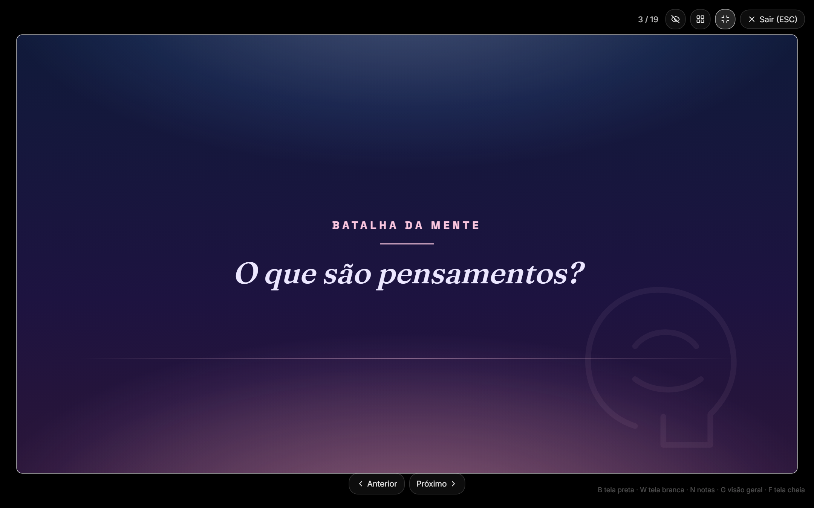
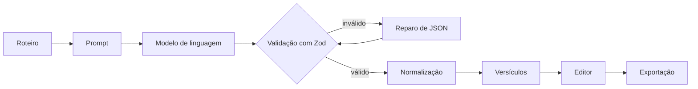

# Visio Divina

Aplicação web que transforma o roteiro de uma pregação em uma apresentação de slides
editável, com exportação para PPTX, PDF e PNG.

[](https://github.com/junior089/visio-divina/actions/workflows/ci.yml)
[](LICENSE)


| Formulário do roteiro                                | Modo apresentação                                           |
| ---------------------------------------------------- | ----------------------------------------------------------- |
|  |  |

As capturas foram feitas no modo demonstração, sem chave de API.

## O que faz

- Recebe o roteiro, o esboço ou o estudo bíblico em texto livre, além de tema, série,
  pregador, estilo do culto, nível de síntese e modo de exibição (telão, tela ou
  impressão).
- Gera a apresentação com um modelo de linguagem. A saída é estruturada em capa,
  tópicos, textos bíblicos, frases de destaque, citações e encerramento.
- Busca o texto dos versículos citados numa API bíblica (Almeida, de domínio público),
  em vez de deixar o modelo escrevê-los de memória.
- Oferece 12 templates visuais, com tom emocional e motivo visual (pão, mar, fogo e
  outros) sugeridos a partir da mensagem.
- Editor de slides com:
  - edição de cada campo, troca de layout e de template;
  - cor e logo da igreja;
  - desfazer e refazer (Ctrl/Cmd+Z);
  - reordenação por arrastar, duplicação e remoção;
  - busca e revisão automática de cada slide.
- Modo apresentação em tela cheia, com tela preta e branca, notas do operador e visão
  geral.
- Exportação:
  - PPTX editável;
  - PDF com um slide por página;
  - PNG em até 4K, compactado em ZIP;
  - roteiro em `.txt` e o deck em JSON.
- Histórico salvo no navegador. Com Supabase configurado, há contas por e-mail e senha
  e as apresentações ficam na nuvem.
- Página `/bastidores` com o prompt enviado, a resposta bruta do modelo e o reparo de
  JSON de cada geração.

## Como a geração funciona



- **Server function.** A geração roda no servidor, na server function `generateSlides`
  (`src/lib/generation/generate-slides.ts`). A chave da API nunca chega ao navegador.
- **Passagens no prompt.** Antes da chamada, as referências bíblicas do roteiro são
  extraídas e o texto delas entra no prompt, para que os slides sejam escritos a partir
  da passagem.
- **Saída estruturada.** O modelo responde com o schema Zod do deck pelo `Output.object`
  do Vercel AI SDK. Se o provedor não aceitar saída estruturada, a chamada é repetida em
  modo texto e o JSON é extraído da resposta, mesmo quando vem dentro de markdown.
- **Validação e reparo.**
  - O schema é tolerante: valores fora do vocabulário, como um layout inventado, viram
    `undefined` e são derivados depois.
  - Se ainda assim a resposta não validar, uma segunda chamada envia o erro de validação
    e pede só a correção do formato.
- **Normalização.** Garante capa e encerramento, pagina textos longos, limita a
  quantidade e o tamanho dos tópicos conforme o modo de exibição e descarta tons e
  motivos que não existem no registro.
- **Fallback.**
  - Sem `NIM_API_KEY`, ou se a chamada falhar (rede, timeout, JSON irrecuperável), a
    aplicação devolve um deck do gerador de demonstração local, com um aviso na
    interface.
  - A falha é registrada no log do servidor com o modelo, a etapa e a duração.
- **Acesso e rate limit.**
  - Com Supabase configurado, só usuários autenticados chegam à chamada do modelo.
  - Cada IP tem um limite de gerações por janela de tempo (padrão: 20 a cada 5
    minutos). Ao exceder, a resposta é a prévia local.
  - O limite fica em memória e vale por processo.

Os detalhes estão em [docs/arquitetura.md](docs/arquitetura.md).

## Stack

- TypeScript, React 19 e [TanStack Start](https://tanstack.com/start) (SSR e server
  functions).
- Tailwind CSS 4 e componentes no padrão shadcn/ui (Radix).
- Zod para validar a entrada do formulário e a resposta do modelo.
- Vercel AI SDK com provedor compatível com OpenAI. Por padrão usa a NVIDIA NIM com
  `meta/llama-3.3-70b-instruct`.
- Supabase: autenticação e PostgreSQL com Row Level Security.
- Exportação: `pptxgenjs` (PPTX), `jsPDF` (PDF), `html-to-image` e `jszip` (PNG).
- Vitest, ESLint e Prettier.
- Docker (servidor Node) e Vercel.

## Como rodar

Pré-requisitos: Node.js 22.12 ou superior e npm.

```bash
npm ci
cp .env.example .env
npm run dev
```

O app abre em http://localhost:8080. A geração fica em `/gerar`.

### Modo demonstração

Deixe `NIM_API_KEY` vazio. O app gera os slides com um gerador local, sem chamar o
modelo, e mostra um aviso na interface. Todo o resto funciona normalmente: editor,
apresentação e exportação. É o modo usado nas capturas acima e o jeito mais rápido de
conhecer o projeto.

Para usar o modelo, gere uma chave em https://build.nvidia.com e preencha `NIM_API_KEY`
no `.env`.

### Contas e salvamento na nuvem (opcional)

1. Crie um projeto no Supabase.
2. Rode `supabase/migrations/0001_init_decks.sql` no SQL Editor.
3. Preencha `VITE_SUPABASE_URL` e `VITE_SUPABASE_ANON_KEY`.

Essas variáveis são lidas no build. Sem elas, o histórico fica no `localStorage` do
navegador.

### Docker

```bash
docker compose up -d --build
docker compose logs -f
docker compose down
```

O app fica em http://localhost:3000.

- O `docker-compose.yml` lê o `.env` em tempo de execução.
- O build usa `BUILD_TARGET=node`, que gera um servidor Node autônomo em
  `.output/server/index.mjs`.
- O compose tem um healthcheck que faz uma requisição a `/`.

Sem o compose:

```bash
docker build -t visio-divina .
docker run --rm -p 3000:3000 --env-file .env visio-divina
```

### Vercel

Com a variável `VERCEL` presente no build, o `vite.config.ts` usa o preset `vercel` do
nitro. O `vercel.json` já define os comandos de instalação e build.

## Variáveis de ambiente

| Variável                       | Onde     | Padrão                                  | Descrição                                                        |
| ------------------------------ | -------- | --------------------------------------- | ---------------------------------------------------------------- |
| `NIM_API_KEY`                  | servidor | vazio                                   | Chave da NVIDIA NIM. Vazia ativa o modo demonstração.            |
| `NVIDIA_BASE_URL`              | servidor | `https://integrate.api.nvidia.com/v1`   | Endpoint compatível com OpenAI.                                  |
| `NVIDIA_MODEL`                 | servidor | `meta/llama-3.3-70b-instruct`           | Modelo usado na geração.                                         |
| `NVIDIA_GENERATION_TIMEOUT_MS` | servidor | `300000`                                | Tempo máximo de cada chamada ao modelo.                          |
| `DEBUG_AI_PROMPT`              | servidor | `false`                                 | Registra prompt e resposta bruta no log do servidor.             |
| `GENERATION_RATE_LIMIT`        | servidor | `20`                                    | Gerações com o modelo permitidas por IP em cada janela.          |
| `GENERATION_RATE_WINDOW_MS`    | servidor | `300000`                                | Tamanho da janela do rate limit.                                 |
| `BIBLE_API_URL`                | servidor | `https://bible-api.com`                 | API da tradução Almeida.                                         |
| `BIBLE_LICENSED_ENABLED`       | servidor | `false`                                 | Libera NVI, ARA e ACF. Use só se tiver licença dessas traduções. |
| `BIBLE_API_TOKEN`              | servidor | vazio                                   | Token da abibliadigital, exigido pelas traduções licenciadas.    |
| `ABIBLIA_API_URL`              | servidor | `https://www.abibliadigital.com.br/api` | API das traduções licenciadas.                                   |
| `VITE_SUPABASE_URL`            | build    | vazio                                   | URL do projeto Supabase.                                         |
| `VITE_SUPABASE_ANON_KEY`       | build    | vazio                                   | Chave pública (anon) do Supabase.                                |
| `PORT`                         | servidor | `3000`                                  | Porta do servidor Node no Docker.                                |
| `BUILD_TARGET`                 | build    | vazio                                   | `node` gera o servidor Node autônomo (usado pelo Dockerfile).    |

As variáveis são validadas em `src/lib/env.ts`. Um valor inválido volta para o padrão.

## Scripts e testes

| Comando                | O que faz                                             |
| ---------------------- | ----------------------------------------------------- |
| `npm run dev`          | Servidor de desenvolvimento na porta 8080.            |
| `npm run build`        | Build de produção.                                    |
| `npm run preview`      | Serve o build localmente.                             |
| `npm test`             | Roda os testes uma vez.                               |
| `npm run test:watch`   | Roda os testes em modo observação.                    |
| `npm run lint`         | ESLint.                                               |
| `npm run typecheck`    | Verificação de tipos com `tsc`.                       |
| `npm run format`       | Formata o código com o Prettier.                      |
| `npm run format:check` | Confere a formatação sem alterar arquivos.            |
| `npm run screenshots`  | Refaz as capturas de `docs/assets` com o app rodando. |

Os testes de unidade usam Vitest e ficam ao lado do código, em `*.test.ts`. Eles cobrem:

- a extração de JSON e o prompt de reparo;
- o schema da resposta;
- a normalização do deck;
- a extração de referências bíblicas;
- o rate limit;
- o gerador de demonstração;
- a recomendação de template, a revisão automática de slides e a montagem do deck a
  partir da resposta.

O CI (`.github/workflows/ci.yml`) roda formatação, lint, typecheck, testes e build em
cada push e pull request.

## Estrutura do projeto

```
src/
├── routes/                     páginas (TanStack Router, roteamento por arquivo)
│   ├── index.tsx               painel com as apresentações recentes
│   ├── gerar.tsx               formulário de geração e editor
│   ├── bastidores.tsx          prompt, resposta bruta e reparo de cada geração
│   ├── projeto.tsx             sobre o projeto
│   └── entrar.tsx              login e cadastro
├── components/
│   ├── generator-form.tsx      formulário do roteiro
│   ├── generator/              seções do formulário, predefinições e montagem do deck
│   ├── slide-preview.tsx       editor da apresentação
│   ├── editor/                 barra de ações, lista de slides, editor do slide, histórico
│   ├── workspace/              painéis da página de geração (etapas, resumo, recentes)
│   ├── slide-canvas.tsx        render de um slide (1920×1080, escalado)
│   ├── presentation-mode.tsx   modo apresentação
│   ├── export-actions.tsx      botões de exportação
│   ├── template-gallery.tsx    comparador de templates
│   └── ui/                     componentes base (shadcn/ui)
├── lib/
│   ├── generation/             server function, prompt, schemas, normalização,
│   │                           tons, motivos e gerador de demonstração
│   ├── bible/                  extração de referências e busca do texto bíblico
│   ├── export/                 PPTX, PDF, imagens e arquivos de texto
│   ├── storage/                repositório de decks, localStorage e Supabase
│   ├── auth/                   contexto de autenticação e validação de token
│   ├── env.ts                  variáveis de ambiente validadas com Zod
│   ├── rate-limit.ts           rate limit em memória
│   ├── read-image-file.ts      leitura de imagens enviadas como data URL
│   └── slide-presets.ts        templates, layouts e modos de exibição
├── types/slides.ts             tipos do deck e dos slides
├── styles.css                  tokens da interface e templates de slide
├── server.ts                   entrada do servidor com página de erro
└── test/fixtures.ts            dados de teste
docs/                           arquitetura, roadmap, padrão visual e capturas
supabase/migrations/            schema do banco (tabela decks com RLS)
scripts/                        geração das capturas de tela
```

## Próximos passos

Lista completa e priorizada em [docs/roadmap.md](docs/roadmap.md).

- Quota diária por usuário persistida no banco, além do rate limit por IP.
- Migrations versionadas com a CLI do Supabase.
- Envio dos erros de geração para um serviço de monitoramento.
- Streaming da geração, com os slides aparecendo conforme chegam.
- Exportação para ProPresenter, OpenLP e EasyWorship.
- Visão do apresentador em segunda tela.
- Importação de roteiro em `.docx` e `.pdf`.
- Compartilhamento de apresentação por link.

## Autores

- Carlos Alberto Soares de Oliveira Júnior ([@junior089](https://github.com/junior089))
- Ítalo Kaubh Galeno de Melo

Projeto de extensão do Centro Universitário de Brasília (UniCEUB).

## Licença

[MIT](LICENSE)
